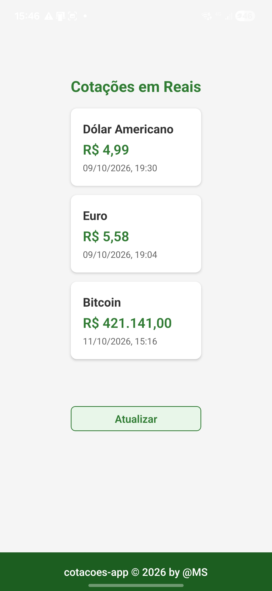
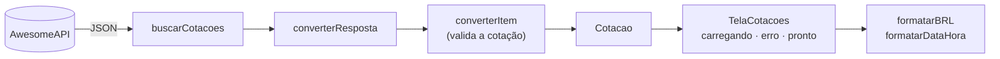

# 📈 Cotações

App Android que mostra as cotações do **Dólar (USD)**, do **Euro (EUR)** e do **Bitcoin (BTC)** em **Reais (R$)**, com a data e a hora de cada cotação.

Feito com **React Native + Expo + TypeScript** e desenvolvido com **TDD** (Test-Driven Development).


<p align="center">
  
</p>

---

## 📲 Baixar e instalar

1. No celular Android, abra a página de **[Releases](https://github.com/marcusteixeirabr/cotacoes-app/releases/latest)** e baixe o arquivo `.apk`.
2. Ao abrir o arquivo, o Android vai pedir permissão para **instalar apps desta fonte** (o navegador). Permita.
3. O Google Play Protect pode avisar que o app é desconhecido, porque ele não vem da Play Store. Isso é esperado.

> **Verificação (opcional):** cada release traz o hash **SHA-256** do APK. Para conferir se o arquivo baixado é o original:
> ```bash
> sha256sum cotacoes-v1.0.0.apk
> ```

## ✨ Funcionalidades

- Cotações de USD, EUR e BTC em reais, com a **data e a hora** de cada uma. Assim fica claro, por exemplo, que no fim de semana o câmbio mostra o fechamento de sexta-feira.
- Botão **Atualizar** para buscar novamente.
- Estados de **carregando** e de **erro**, com o botão **Tentar de novo**.
- Valores no padrão brasileiro (`R$ 1.234,50`) e horário de Brasília.

## 🧭 Como funciona



| Camada | Arquivo | Papel |
|---|---|---|
| Domínio | `src/dominio/cotacao.ts` | O tipo `Cotacao`, nos termos do app: `codigo`, `nome`, `valor`, `atualizadoEm` |
| Adaptador | `src/api/awesome.ts` | Busca na AwesomeAPI e traduz a resposta para o domínio. Trocar de API muda só este arquivo |
| Apresentação | `src/utils/moeda.ts`, `src/utils/data.ts` | Formatação de moeda e de data/hora |
| Tela | `src/telas/TelaCotacoes.tsx` | Estado (`carregando` / `erro` / `pronto`) e interface |

A tela recebe **a função que carrega os dados** como propriedade. Por isso, durante o desenvolvimento ela foi construída com dados gravados (*fixtures*), sem fazer nenhuma requisição, e a troca para a API real foi de uma linha só.

## 🧪 Testes (TDD)

São **21 testes** em 3 suítes, escritos **antes** do código (ciclo vermelho → verde → refatorar):

| Suíte | O que garante |
|---|---|
| `moeda.test.ts` | Formatação em reais: milhar, centavos, zero, negativos, arredondamento e o espaço não separável (NBSP) entre `R$` e o número |
| `awesome.test.ts` | Conversão da resposta da API: texto → número, *timestamp* em segundos → `Date`, extração do nome e **rejeição de cotações inválidas** (`"abc"`, `""`, `" "`, `"0"`, `"-5"`, `"Infinity"`) |
| `data.test.ts` | Data/hora sempre no fuso de Brasília, inclusive perto da meia-noite UTC |

Algumas decisões que tornam os testes confiáveis:

- **Sem rede nos testes:** a resposta da API foi gravada em `src/api/__fixtures__/`. Os testes rodam em segundos, inclusive offline.
- **Fuso fixo nos testes (`TZ=UTC`):** os testes rodam num fuso diferente do usado pelo código. Assim, se alguém remover o `timeZone` da formatação, eles falham, seja qual for o fuso da máquina.
- **Regra de domínio, não casos especiais:** uma cotação válida é *um número finito e maior que zero*. Uma única regra cobre todas as entradas inválidas.
- **Typecheck separado:** o Jest não verifica tipos, então `npm run check` roda o `tsc` **e** os testes.

```bash
npm run check        # typecheck + testes (rodar antes de cada commit)
npm run test:watch   # modo TDD: reexecuta a cada salvamento
```

## 🛠️ Rodando localmente

**Requisitos:** Node.js 24 LTS e o app **Expo Go** no celular Android. O repositório também traz um **devcontainer** (`.devcontainer/`) com o ambiente pronto.

```bash
git clone https://github.com/marcusteixeirabr/cotacoes-app.git
cd cotacoes-app
npm ci
npm run check
npx expo start --tunnel   # escaneie o QR code com o Expo Go
```

### Gerando o APK

O APK é compilado na nuvem pelo **EAS Build**, e é preciso ter uma conta Expo:

```bash
npm install --global eas-cli
eas login
eas build -p android --profile preview   # perfil "preview" gera .apk
```

## 🧰 Stack

| | |
|---|---|
| Framework | React Native 0.86 + Expo SDK 57 |
| Linguagem | TypeScript 6 (modo `strict`) |
| Testes | Jest 29 + jest-expo |
| Build | EAS Build |
| Dados | [AwesomeAPI – API de Cotações](https://docs.awesomeapi.com.br/api-de-moedas) |
| Ambiente | Devcontainer (Node 24) |

## 💡 Aprendizados técnicos

- **Um 429 que não era excesso de requisições.** O app recebia `HTTP 429` enquanto navegador e `curl` recebiam `200`, do mesmo IP. Um experimento mudando uma única variável, o `User-Agent`, mostrou que um filtro do Cloudflare barrava a identificação padrão do Android (`okhttp`). A solução foi o app se identificar **honestamente**, com um `User-Agent` próprio.
- **Testes no Node, app no Hermes.** Formatações que dependem da plataforma (`Intl`) foram conferidas também no aparelho.
- **Ponto flutuante:** `toFixed`, `Math.round` e `Intl` arredondam `1.005` de formas diferentes. Os valores só são formatados na apresentação.

## 🗺️ Próximos passos

- [ ] Mensagens de erro amigáveis (hoje, sem internet, aparece a mensagem técnica do sistema)
- [ ] Conversor: digitar um valor em qualquer moeda e ver as outras, incluindo BTC em **satoshis**, com cálculo em inteiros
- [ ] Validar também o *timestamp* recebido da API

## ⚠️ Aviso

Os valores são **apenas informativos** e vêm de uma API pública de terceiros, com atraso de até alguns minutos. Não são recomendação de investimento. Este projeto não tem relação com a AwesomeAPI.

## 📄 Licença

[MIT](LICENSE) © 2026 Marcus Teixeira
